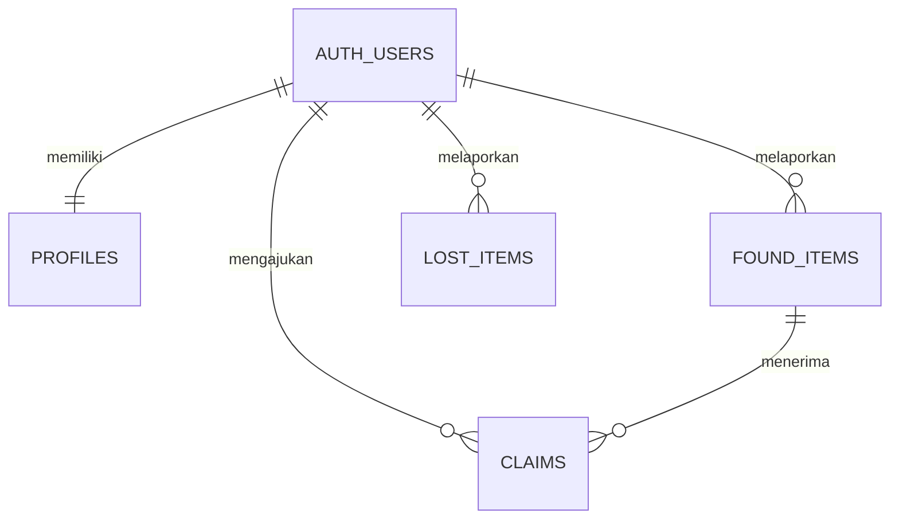

# Rancangan database Ditemukan dan Profil

Migrasi ini ditujukan untuk **skema existing yang diberikan**, bukan menjalankan ulang `CREATE TABLE` dari dashboard. Belum diterapkan ke project Supabase langsung oleh pengujian lokal.



| Tabel | Perubahan dan tujuan |
| --- | --- |
| `profiles` | `id` mengacu `auth.users.id`; nama tampilan, kampus, email kontak, telepon, persetujuan berbagi kontak, waktu buat/perbarui. Email kontak terpisah dari email login. |
| `found_items` | Tambah `campus`, `category`, `custody_type`, `pickup_location`, `pickup_notes`, `updated_at`. Lokasi ditemukan berbeda dari tempat pengambilan. |
| `claims` | Satu pengajuan per pengguna/barang; maksimal satu persetujuan. Hanya peserta melihat bukti. Keputusan menggunakan RPC pelapor, dicatat pada `decided_by`/`decided_at`. |
| `lost_items` | Struktur tetap; RLS baca pengguna login dan tulis milik sendiri. |

Kategori: `electronics`, `documents`, `keys`, `bags`, `clothing`, `other`. Penyimpan: `reporter`, `security`, `lost_and_found`. Status Found tetap `open`, `returned`, `closed` agar model dan beranda tetap kompatibel.

Nama kampus merupakan teks, bukan bukti keanggotaan/otorisasi kampus. Seluruh pengguna login masih bisa melihat seluruh laporan. Verifikasi domain email/keanggotaan dan tabel master kampus diperlukan terpisah jika aplikasi harus membatasi akses antar kampus. Jangan mengumpulkan NIM atau kartu identitas hanya untuk menampilkan profil.

## Penerapan

1. Buat backup/snapshot database; tinjau policy existing bersama pemilik modul Hilang dan Klaim. Migrasi pertama **mengganti seluruh policy pada empat tabel aplikasi** agar policy permisif lama tidak membypass kepemilikan. Policy lain di luar tabel ini tidak dihapus.
2. Periksa duplikasi sebelum menjalankan migrasi:

   ```sql
   select found_item_id, claimant_id, count(*) from public.claims
   group by found_item_id, claimant_id having count(*) > 1;
   select found_item_id, count(*) from public.claims where status = 'approved'
   group by found_item_id having count(*) > 1;
   ```

   Jika ada hasil, putuskan penyelesaian manual dengan tim. Migrasi sengaja gagal, bukan menghapus bukti klaim secara otomatis.
3. Terapkan [202611160001_found_profiles.sql](../supabase/migrations/202611160001_found_profiles.sql), kemudian [202611160002_found_storage.sql](../supabase/migrations/202611160002_found_storage.sql) melalui SQL Editor Supabase atau migration runner. Masing-masing bersifat transaksional dan **dijalankan sekali**, bukan script reset. Periksa apakah nama tabel/fungsi/index telah dipakai sebelum penerapan.
4. Migrasi membentuk profil untuk pengguna lama, lalu trigger membentuk profil pengguna baru. Nama dari metadata dibatasi panjangnya; kontak selalu kosong dan privat pada awalnya.
5. Isi konfigurasi lokal privat sesuai README, Sync/Build, lalu uji dengan minimal dua akun di perangkat.

Data laporan lama tidak dihapus. Kampus dan lokasi pengambilan lama ditampilkan sebagai “belum diisi”; pelapor wajib melengkapinya saat mengedit. Lengkapi informasi tersebut sebelum memutuskan klaim melalui RPC agar validasi laporan dapat lolos. Klien lama yang belum mengirim kolom baru akan ditolak saat membuat laporan; koordinasikan penerapan database dan rilis klien.

## Akses dan pengambilan barang

- Tabel profil hanya dapat dibaca/ditulis pemilik. Nama/kampus pelapor dibaca melalui `get_found_reporter(p_found_item_id uuid)`. Server hanya mengembalikan email/telepon jika `share_contact=true` atau pemanggil adalah pemilik profil.
- Opsi berbagi kontak dapat dicabut; permintaan RPC berikutnya langsung disaring. Informasi yang sudah disalin oleh pengguna lain tidak bisa ditarik kembali. Halaman detail memuat ulang profil saat dibuka atau melalui tombol muat ulang.
- Email memakai aplikasi email (`mailto:`), telepon membuka dialer (`tel:`), tanpa menelepon otomatis. Kontak langsung untuk koordinasi, bukan pengganti bukti kepemilikan.
- Klien tidak dapat mengubah status klaim langsung. API `review_found_claim(p_claim_id uuid, p_approve boolean)` hanya untuk pelapor dan transaksi mengunci laporan: satu klaim disetujui, pesaing ditolak, barang menjadi `returned`. UI modul Klaim masih placeholder; RPC ini menyiapkan kontrak integrasinya.
- FK klaim ke laporan dipertahankan. Laporan yang punya klaim tidak bisa dihapus; tutup laporan agar riwayat tetap ada. Laporan tanpa klaim dapat dihapus pemilik, lalu foto dibersihkan; kegagalan pembersihan ditampilkan sebagai peringatan.
- Bucket `temubarang-images` mengikuti alur foto publik yang sudah dipakai aplikasi. Bucket baru dibatasi JPG/PNG/WEBP dan 5 MB; bucket existing tidak diubah diam-diam. Periksa batas file/MIME pada dashboard jika bucket sudah ada. Bucket privat menyebabkan migrasi Storage berhenti agar privasinya tidak berubah otomatis.
- Foto publik dapat diakses siapa pun yang memiliki URL. Jangan unggah identitas, kontak privat, atau ciri rahasia untuk bukti klaim. Unggah/hapus hanya pada `<auth.uid()>/found/<nama-file>`; restrictive guards memblokir akses silang meski ada policy permisif lama. Overwrite foto pada folder `found` diblokir; gunakan nama UUID baru. Modul lain tetap dapat memakai folder milik pengguna sendiri dengan policy khusus modulnya; guard kepemilikan berlaku untuk bucket bersama.

## Validasi lokal dan perangkat

```bash
bash gradlew :app:assembleDebug :app:testDebugUnitTest :app:lintDebug
npm --prefix supabase/tests ci
npm --prefix supabase/tests test
```

Pengujian database memakai PostgreSQL WASM (PGlite) dengan fixture Auth dan Storage minimal; tidak meniru server Auth/Storage HTTP atau membuktikan konektivitas project live. Test meliputi migrasi data lama, trigger signup, privasi kontak, RLS pemilik, anti-spoofing, klaim ganda/self-approval, keputusan atomik, dan policy folder Storage. Race lintas koneksi perlu diperiksa pada staging PostgreSQL; pengujian lokal satu koneksi memeriksa invariant dan hasil transaksi.

Checklist perangkat setelah migrasi:

- Profil ada di navbar kelima; simpan, buka ulang, logout/login, dan pastikan data sesuai akun.
- Akun B melihat nama/kampus A tetapi tidak kontak ketika berbagi mati; aktifkan/cabut lalu muat ulang detail.
- Buat/edit laporan dengan kampus, kategori, lokasi penemuan, penyimpan, lokasi/petunjuk pengambilan; verifikasi di daftar dan beranda.
- Pencarian kampus/lokasi, filter Tersedia, dan Laporan Saya menampilkan hasil sesuai data.
- Kamera/galeri mempertahankan draft termasuk kolom baru; foto berhasil diunggah dan dapat dimuat.
- Pengguna lain tidak dapat mengedit/hapus; DELETE dengan klaim ditolak; tanpa klaim baris dan foto terhapus.
- Uji RPC klaim di staging dengan JWT peserta, termasuk dua persetujuan bersamaan. Jangan menggunakan `service_role` pada APK.
